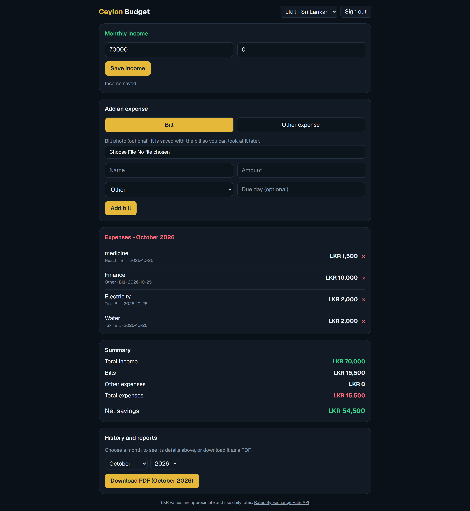

# Ceylon Budget

A simple monthly budget app for Sri Lankans living abroad. Track income, bills and expenses in your local currency, and see how much you saved in Sri Lankan rupees (LKR).

**Live demo:** ceylon-budget-661b.vercel.app



## Why I built this

Many Sri Lankans work abroad (for example in Israel or the Gulf) and send money home. The question they ask every month is: "How much did I save, and what is that in rupees?" Most budget apps do not answer that, so I built one that does.

## Features

- Email sign up and sign in (Supabase Auth)
- Monthly income, bills and everyday expenses with categories
- Bills can have a photo attached; photos are stored privately
- Choose any ISO currency; totals and each expense show an approximate LKR value
- Month and year history; past months are read-only
- Download a monthly report as a PDF (uses the browser print dialog, so Sinhala and Hebrew text prints correctly)
- Light and dark colours that follow the device setting

## Tech stack

| Area | Choice |
|---|---|
| Framework | Next.js (App Router), React, TypeScript |
| Styling | Tailwind CSS with CSS variable theme tokens |
| Database, auth, storage | Supabase (PostgreSQL) |
| Exchange rates | ExchangeRate-API open endpoint, cached on the server |
| Hosting | Vercel |

## How it works

- **Security:** every table has Row Level Security, so a signed-in user can only read and write their own rows. The browser only ever uses the public anon key.
- **Bill photos:** stored in a private Supabase Storage bucket under a folder named after the user's id. The app shows them through short-lived signed URLs. Photos are resized in the browser before upload.
- **Exchange rates:** `src/app/api/rates/route.ts` fetches rates on the server and caches them for 6 hours, so the app does not call the rate provider on every page view.
- **PDF report:** a print-only layout in the dashboard page is shown when printing; the screen layout is hidden.

## Getting started

You need Node.js (LTS) and a free [Supabase](https://supabase.com) project.

```bash
git clone https://github.com/YOUR-USERNAME/ceylon-budget.git
cd ceylon-budget
npm install
```

1. In your Supabase project, open **SQL Editor**, paste the contents of `supabase/schema.sql` and run it. If asked about Row Level Security, choose "Run and enable RLS".
2. For local development you can turn off **Authentication > Providers > Email > Confirm email**.
3. Copy `.env.example` to `.env.local` (Windows: `copy .env.example .env.local`) and fill in your Project URL and anon key from **Project Settings > API**.
4. Start the app:

```bash
npm run dev
```

Open http://localhost:3000.

## Project structure

```
src/
  app/
    api/rates/route.ts    Cached exchange-rate endpoint
    dashboard/page.tsx    Main screen: income, expenses, history, PDF report
    login/page.tsx        Sign in and sign up
    page.tsx              Redirects to /login
    globals.css           Theme tokens (light and dark) and print styles
  lib/
    categories.ts         Expense categories
    currencies.ts         Currency list from the browser's Intl API
    image.ts              Browser-side image resizing
    supabase/client.ts    Supabase browser client
supabase/
  schema.sql              Tables, security policies and storage bucket
```

## Known limitations and roadmap

- Changing the currency only changes the label; saved amounts are not converted. Storing a currency per record is planned.
- A bill counts in the month it was added. A `bill_date` column and recurring bills are planned.
- LKR values always use the latest rate, not the rate of the selected month.
- The interface is English only. A Sinhala / English switch and a manual dark mode toggle are planned.
- Reading bill photos automatically (OCR) and installing the app on a phone (PWA) are ideas for later.
- No automated tests yet.

## Credits

Exchange rates by [Exchange Rate API](https://www.exchangerate-api.com).

## License

MIT, see [LICENSE](LICENSE).
